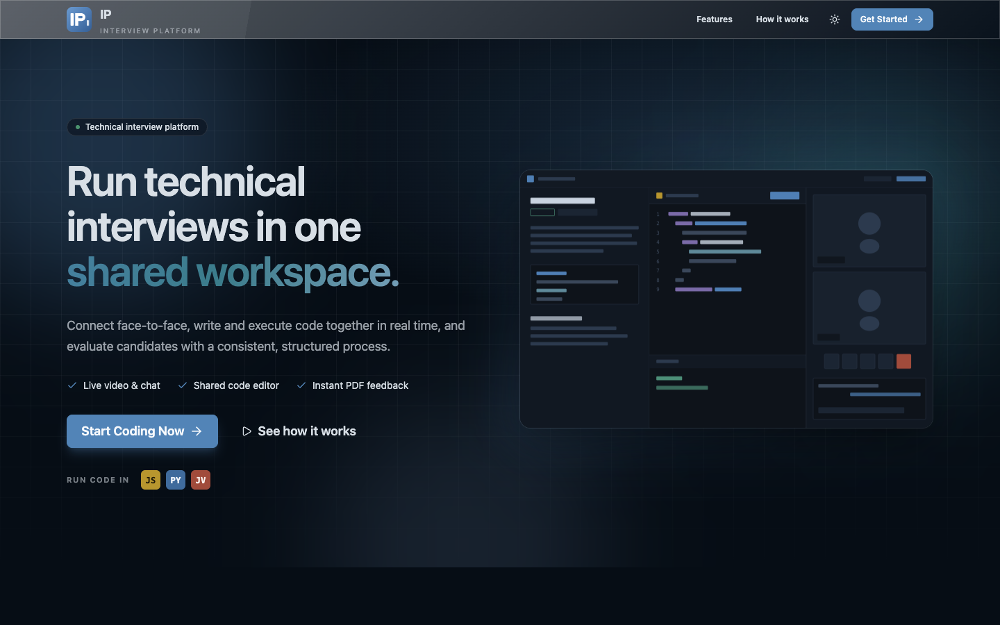

<h1 align="center">IP: Interview Platform</h1>

<p align="center">
  A full-stack platform for live technical interviews: shared code editor, 1-on-1 video,
  real-time chat and sandboxed code execution in a single room.
</p>



## Features

- **1-on-1 interview rooms** with video, screen sharing, mic/camera controls and recording
- **Real-time chat** inside every session
- **Device detection**: the host's browser (in a Web Worker, so the call never freezes) looks for phones and laptops on the candidate's camera, marks them with a red box that follows the device, warns both sides and removes the candidate after a short countdown. Nothing is uploaded or recorded. Earphones can not be detected by the model, so the host has a *Report device* button. The host can cancel a false alarm or switch the feature off, and the candidate is always told it is on
- **Live translation of speech** in the video call: each person's speech is transcribed in their browser and shown to the other side as subtitles translated into the page language (English, Azerbaijani, Russian)
- **Code editor** powered by Monaco (the VS Code editor) with JavaScript, Python and Java
- **Server-side code execution** in a remote sandbox (Judge0 or Piston). The server judges the output, so a result cannot be faked from the browser
- **Practice mode**: solve curated problems on your own
- **Dashboard** with live sessions, session history and quick join / rejoin
- **Interview quiz**: multiple-choice questions per problem, graded on the server (the answer key never reaches the candidate before the interview ends). Partial answers can be submitted
- **Question bank**: hosts add, edit and delete their own questions, and can change the questions of a running interview
- **Live session management**: the host can switch the problem, remove the candidate, copy an invite link; both sides see roles and status, elapsed time and a live shared editor
- **History**: time spent, correct / incorrect / unanswered answers and the outcome of every interview, searchable and filterable
- **Interview result and PDF feedback**: the interviewer (or the candidate, with *Submit & finish*) ends the session; the candidate sees their mistakes, the correct answers and the outcome, gets a PDF report, and can receive it by email
- **Room locking**: a session accepts only two participants
- **Authentication** with Clerk
- **Background jobs** with Inngest (user sync between Clerk, MongoDB and Stream)
- Interface in **English, Azerbaijani and Russian** (switch in the navbar, remembered per browser)
- Modern UI with dark and light themes, a command palette (Ctrl/Cmd + K), subtle motion that respects `prefers-reduced-motion`, and a lightweight, code-split bundle
- Time limits with a countdown, private host notes that autosave to the server, ratings, CSV export and a weekly activity chart

## Tech stack

| Layer | Technologies |
| --- | --- |
| Frontend | React 19, Vite, Tailwind CSS 4, daisyUI 5, React Router 7, TanStack Query, Monaco Editor |
| Backend | Node.js, Express 5, Mongoose |
| Realtime | Stream Video & Chat |
| Auth | Clerk |
| Jobs | Inngest |
| Database | MongoDB (Atlas) |
| Code execution | Judge0 CE (default) or Piston, called from the backend |
| Email / PDF | Nodemailer (SMTP), jsPDF |

## Project structure

```
Interview-Platform
├── backend
│   └── src
│       ├── controllers   # session + chat (Stream token) handlers
│       ├── middleware    # protectRoute (Clerk auth + user lookup)
│       ├── models        # User, Session
│       ├── routes        # /api/sessions, /api/chat
│       └── lib           # db, env, stream, inngest
└── frontend
    └── src
        ├── api           # axios session API
        ├── components    # UI building blocks
        ├── data          # practice problems + language config
        ├── hooks         # sessions, Stream client, code runner
        ├── lib           # axios, piston, helpers
        └── pages         # Home, Dashboard, Problems, Problem, Session
```

## Getting started

### Prerequisites

- Node.js 18+
- A free account on each of: [MongoDB Atlas](https://www.mongodb.com/atlas),
  [Clerk](https://clerk.com), [Stream](https://getstream.io) and [Inngest](https://www.inngest.com)

### 1. Clone and install

```bash
git clone https://github.com/mahammadali-k/Interview-Platform.git
cd Interview-Platform

npm install --prefix backend
npm install --prefix frontend
```

### 2. Environment variables

Copy the example files and fill in your keys:

```bash
cp backend/.env.example backend/.env
cp frontend/.env.example frontend/.env
```

**`backend/.env`**

```bash
PORT=3000
NODE_ENV=development

DB_URL=your_mongodb_connection_url

INNGEST_EVENT_KEY=your_inngest_event_key
INNGEST_SIGNING_KEY=your_inngest_signing_key

STREAM_API_KEY=your_stream_api_key
STREAM_API_SECRET=your_stream_api_secret

CLERK_PUBLISHABLE_KEY=your_clerk_publishable_key
CLERK_SECRET_KEY=your_clerk_secret_key

CLIENT_URL=http://localhost:5173
```

**`frontend/.env`**

```bash
VITE_CLERK_PUBLISHABLE_KEY=your_clerk_publishable_key
VITE_API_URL=http://localhost:3000/api
VITE_STREAM_API_KEY=your_stream_api_key
```

Optional backend settings (see `backend/.env.example`):

| Variable | Purpose |
| --- | --- |
| `CODE_RUNNER`, `JUDGE0_URL`, `PISTON_URL` | Which sandbox executes code. The public Piston API is whitelist-only since Feb 2026, so Judge0 is the default |
| `TRANSLATE_PROVIDER`, `MYMEMORY_EMAIL`, `DEEPL_API_KEY`, `GOOGLE_TRANSLATE_API_KEY` | Translation service for live call subtitles. The free MyMemory service is the default; DeepL or Google give better quality and higher limits |
| `SMTP_HOST`, `SMTP_PORT`, `SMTP_USER`, `SMTP_PASS`, `MAIL_FROM` | Any SMTP provider (for Gmail use an app password). Without `SMTP_HOST` feedback emails are disabled and the PDF is still downloadable |

> `.env` files are git-ignored. Never commit real keys. The Stream **secret** and Clerk
> **secret** keys belong to the backend only.

### 3. Run

In two terminals:

```bash
# terminal 1: API on http://localhost:3000
cd backend
npm run dev

# terminal 2: app on http://localhost:5173
cd frontend
npm run dev
```

`nodemon` does not watch `.env`; restart the backend after changing it.
Vite reads `.env` at start, so restart the frontend as well.

## Scripts

| Location | Command | Description |
| --- | --- | --- |
| `backend` | `npm run dev` | Start the API with nodemon |
| `backend` | `npm start` | Start the API with node |
| `frontend` | `npm run dev` | Start the Vite dev server |
| `frontend` | `npm run build` | Production build |
| `frontend` | `npm run lint` | Run ESLint |
| root | `npm run build` | Install dependencies and build the frontend |
| root | `npm start` | Start the backend (serves `frontend/dist` in production) |

## API

All routes require a Clerk session and live under `/api`.

| Method | Route | Purpose |
| --- | --- | --- |
| `POST` | `/sessions` | Create a session |
| `GET` | `/sessions/active` | List active sessions |
| `GET` | `/sessions/my-recent` | List your recent sessions |
| `GET` | `/sessions/:id` | Get a session |
| `GET` | `/sessions/history` | Finished interviews with time spent and quiz counts |
| `PATCH` | `/sessions/:id` | Switch the problem or time limit of a running session (host) |
| `PATCH` | `/sessions/:id/notes` | Autosave the host's private notes |
| `POST` | `/sessions/:id/join` | Join a session as participant |
| `POST` | `/sessions/:id/remove-participant` | Remove the candidate (host) |
| `POST` | `/sessions/:id/end` | End a session; the host may send `{ decision, notes }`, the candidate ends with the suggested result |
| `PATCH` | `/sessions/:id/result` | Change the decision or notes of a finished interview (host) |
| `GET` | `/sessions/:id/quiz` | Quiz questions (answer key for the host, or after the interview) |
| `POST` | `/sessions/:id/quiz` | Submit the candidate's answers (once, partial is fine) |
| `POST` / `PUT` / `DELETE` | `/sessions/:id/quiz/questions[/:questionId]` | Add, edit, delete a question of the running interview (host) |
| `GET` | `/sessions/:id/report` | Feedback report of a completed session |
| `GET` | `/sessions/:id/report.pdf` | The feedback PDF |
| `POST` | `/sessions/:id/report/email` | Email the PDF to the candidate (host) |
| `POST` | `/translate` | Translate a caption (`text`, `from`, `to`) for live call subtitles |
| `POST` | `/execute` | Run code in the sandbox and judge it (`language`, `code`, `problem` or `sessionId`) |
| `GET` `POST` `PUT` `DELETE` | `/questions[/:id]` | The host's question bank |
| `GET` | `/chat/token` | Get a Stream token for video and chat |

## How it works

1. A user signs in with Clerk; the backend creates the matching MongoDB user (and the
   Stream user) on first request, or via the Inngest `clerk/user.created` event.
2. The host creates a session by choosing a problem. A Stream call and chat channel are
   created from the session's `callId`.
3. A second user joins from the dashboard. Both see the same problem, run code through
   Piston and talk over video and chat.
4. The candidate answers the quiz tab and runs code (executed and judged on the server); the host follows progress, sees the answer key and can edit questions or the problem.
5. The host ends the interview and picks Accept or Reject (suggested from the tests and a 60% quiz threshold), or the candidate uses *Submit & finish*, even with unanswered questions.
6. Both sides land on the feedback page. The PDF is generated on the server, downloaded by the candidate and emailed when SMTP is configured. The host keeps everything in *History*.

## Deployment

The app deploys as **one web service**: the Express server also serves the built frontend, so there
is no CORS to configure and the API lives at the same origin (`/api`).

### Render (Blueprint)

1. Push the repository to GitHub.
2. In Render: **New + > Blueprint**, pick this repository. [`render.yaml`](render.yaml) describes the service.
3. Fill in the variables marked as secrets (they are never stored in git):

   | Variable | Value |
   | --- | --- |
   | `CLIENT_URL` | the public URL of the service, e.g. `https://interview-platform.onrender.com` |
   | `DB_URL` | MongoDB Atlas connection string (allow `0.0.0.0/0` in Network Access) |
   | `CLERK_PUBLISHABLE_KEY`, `VITE_CLERK_PUBLISHABLE_KEY` | same Clerk publishable key |
   | `CLERK_SECRET_KEY` | Clerk secret key |
   | `STREAM_API_KEY`, `VITE_STREAM_API_KEY` | same Stream key |
   | `STREAM_API_SECRET` | Stream secret |
   | `INNGEST_EVENT_KEY`, `INNGEST_SIGNING_KEY` | Inngest keys |
   | `SMTP_*`, `MAIL_FROM` | optional, for feedback emails |

   `VITE_*` variables are baked into the frontend **at build time**, so changing one needs a new deploy.
4. After the first deploy, in Clerk add the service URL to the allowed origins (use a *Production*
   instance and `pk_live_` / `sk_live_` keys for real users), and in Inngest sync the app with
   `https://<your-service>/api/inngest`.

### Fly.io

`fly.toml` and the `Dockerfile` are in the repository root, so the **Config path** is the default
(`fly.toml`, or leave it empty).

```bash
fly launch --no-deploy --copy-config      # keeps fly.toml; pick a free app name and update `app` / CLIENT_URL in it
fly secrets set \
  DB_URL="..." CLERK_SECRET_KEY="..." STREAM_API_SECRET="..." \
  INNGEST_EVENT_KEY="..." INNGEST_SIGNING_KEY="..." SMTP_PASS="..."
fly deploy
```

Public values (Clerk publishable key, Stream key, URLs) are already in `fly.toml`; only the secrets
go through `fly secrets`. After the first deploy, add `https://<app>.fly.dev` to the allowed origins
in Clerk and sync `https://<app>.fly.dev/api/inngest` in Inngest.

### Any other Node host

```bash
npm run build   # installs both packages and builds the frontend
npm start       # NODE_ENV=production serves frontend/dist and the API on $PORT
```

Health check: `GET /health`.

## Author

**Mahammadali**: [github.com/mahammadali-k](https://github.com/mahammadali-k)
